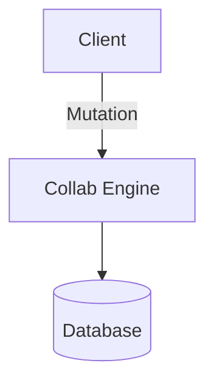

# Glyphroom Model Context Protocol (MCP) Server

The Glyphroom MCP Server provides a standardized [Model Context Protocol](https://modelcontextprotocol.io/) interface for AI coding assistants and autonomous agents to safely collaborate on enterprise technical documents, RFCs, and architecture designs.

---

## 1. Transports & Connectivity

The MCP server supports two transport protocols configured via `MCP_TRANSPORT` or flags:

### A. Streamable HTTP Transport (Default, Port 5000)
Operates stateless HTTP RPC over `/mcp`.
- **URL**: `http://127.0.0.1:5000/mcp`
- **Health Check**: `http://127.0.0.1:5000/healthz`
- **Required Headers**:
  - `Content-Type: application/json`
  - `Accept: application/json, text/event-stream`
  - `Authorization: Bearer <GLYPHROOM_PAT>`

### B. Stdio Transport
For local execution where an agent process launches the MCP server binary as a subprocess.
- **Command**: `pnpm --filter @glyphroom/mcp-server start --stdio`
- **Environment**: Set `GLYPHROOM_PAT=eb_pat_...` in the environment.

---

## 2. Authentication & Scopes

All mutating operations require an authenticated Personal Access Token (PAT). Tokens start with the prefix `eb_pat_`.

| Scope | Required By Tools | Description |
|---|---|---|
| `posts:read` | `get_post`, `search_posts` | Search catalog and read post working/published drafts. |
| `posts:draft` | `create_post` | Create new posts strictly in isolated draft state. |
| `posts:suggest` | `append_section`, `insert_after_section`, `suggest_edit_section` | Propose additive sections or diff-based suggestion marks. |
| `comments:write` | `add_comment` | Post review comments or replies on documents. |
| `posts:publish` | `publish_post` | Publish an approved publication checkpoint. |

---

## 3. Markdown Formatting Guidelines

> [!IMPORTANT]
> **Real Newlines vs. Escaped Characters**
>
> When submitting Markdown `content` to MCP tools (`create_post`, `append_section`, `insert_after_section`, `suggest_edit_section`):
> - **Must use raw line break control characters (`\n` / 0x0A)**.
> - **Never send double-escaped literal string sequences (`\\n`)**. Sending `\\n` as literal text bypasses block splitting and causes entire multiline documents to render as a single unformatted text block.
> - When formatting JSON in Python, TypeScript, or curl, ensure strings contain true newlines or unescaped newline escapes in template literals.

### Supported Rich Content Blocks

Glyphroom parses and renders the following Markdown components across the collaborative editor, reader view, and derived export:

#### 1. Headings (Levels 1 to 6)
```markdown
# Level 1 Heading
## Level 2 Heading
### Level 3 Heading
```

#### 2. Callout Alerts (GitHub-style)
```markdown
> [!NOTE]
> Informational context and design notes.

> [!TIP]
> Best practice advice or optimization tips.

> [!IMPORTANT]
> Critical architectural requirements.

> [!WARNING]
> Deprecations, breaking changes, or cautionary notes.

> [!CAUTION]
> High-risk operations or potential security vulnerabilities.
```

#### 3. Standard Blockquotes
```markdown
> Single or multi-line quoted citation or reference.
```

#### 4. Mermaid Diagrams
````markdown

````

#### 5. KaTeX Math Formulas
```markdown
Display formula:
$$ E = mc^2 $$

Inline formula: $a^2 + b^2 = c^2$
```

#### 6. Code Blocks
````markdown
```typescript
interface ServiceConfig {
  port: number;
  host: string;
}
```
````

#### 7. Task Lists & Checklists
```markdown
- [ ] Task pending implementation
- [x] Completed task item
```

#### 8. Tables
```markdown
| Method | Endpoint | Description |
|---|---|---|
| GET | /api/v1/posts | Catalog search |
| POST | /api/v1/posts | Create draft |
```

#### 9. Status Pulse Cards
```markdown
<!-- status-block ragStatus="green" milestoneTitle="Phase 1 Launch" completionPercent="80" targetDate="2026-12-01" blockers="None" -->
```

---

## 4. Tool Catalog

### `create_post`
Creates a new draft post on behalf of the agent owner. Defaults strictly to draft status.
- **Parameters**:
  - `title` *(string, required)*: Post title (1-500 characters).
  - `content` *(string, required)*: Initial Markdown body using raw newlines.
  - `excerpt` *(string, optional)*: Short 1-2 sentence summary for cards (max 2000 chars).
  - `tags` *(string[], optional)*: Array of tag strings (max 20 tags).
  - `coeId` *(string, optional)*: Center of Excellence UUID.

### `get_post`
Retrieves a post snapshot in Markdown, outline summary, or ProseMirror JSON.
- **Parameters**:
  - `postId` *(string, required)*: UUID or slug of the post.
  - `format` *(enum: `"markdown"` \| `"summary"` \| `"prosemirror_json"`, default: `"markdown"`)*.
  - `includeSuggestions` *(boolean, default: false)*.

### `search_posts`
Searches posts with full-text search and visibility isolation.
- **Parameters**:
  - `query` *(string, required)*: Search keywords.
  - `tags` *(string[], optional)*: Filter by tags.
  - `limit` *(integer, default: 10, max: 50)*.
  - `offset` *(integer, default: 0)*.

### `append_section`
Appends a section to the end of a document working copy.
- **Parameters**:
  - `postId` *(string, required)*: UUID or slug.
  - `heading` *(string, optional)*: Section heading title.
  - `content` *(string, required)*: Markdown content block.

### `insert_after_section`
Inserts a section immediately after an existing target section.
- **Parameters**:
  - `postId` *(string, required)*: UUID or slug.
  - `targetHeading` *(string, required)*: Heading of existing target section.
  - `heading` *(string, optional)*: New heading to insert.
  - `content` *(string, required)*: Markdown content block.

### `suggest_edit_section`
Proposes an edit to an existing section using non-destructive suggestion marks.
- **Parameters**:
  - `postId` *(string, required)*: UUID or slug.
  - `targetHeading` *(string, required)*: Section to modify.
  - `newContent` *(string, required)*: Proposed Markdown content.
  - `instruction` *(string, optional)*: Reason for the proposed edit.

### `add_comment`
Adds a review comment or anchored question.
- **Parameters**:
  - `postId` *(string, required)*: UUID or slug.
  - `content` *(string, required)*: Comment body.
  - `parentId` *(string, optional)*: Parent comment UUID for replies.
  - `anchorHeading` *(string, optional)*: Unique heading label to anchor to.

### `publish_post`
Publishes the current approved checkpoint after review.
- **Parameters**:
  - `postId` *(string, required)*: UUID or slug.
  - `notes` *(string, optional)*: Operational notes.

---

## 5. Sample Request

```json
{
  "jsonrpc": "2.0",
  "id": 1,
  "method": "tools/call",
  "params": {
    "name": "create_post",
    "arguments": {
      "title": "Zero-Trust Agent Governance",
      "excerpt": "Architectural guidelines for scoped agentic integrations.",
      "tags": ["security", "mcp", "architecture"],
      "content": "# Zero-Trust Agent Governance\n\n> [!NOTE]\n> All agent mutations must be authenticated via scoped PAT.\n\n## Overview\n\nAgent integrations operate in isolated working drafts."
    }
  }
}
```

